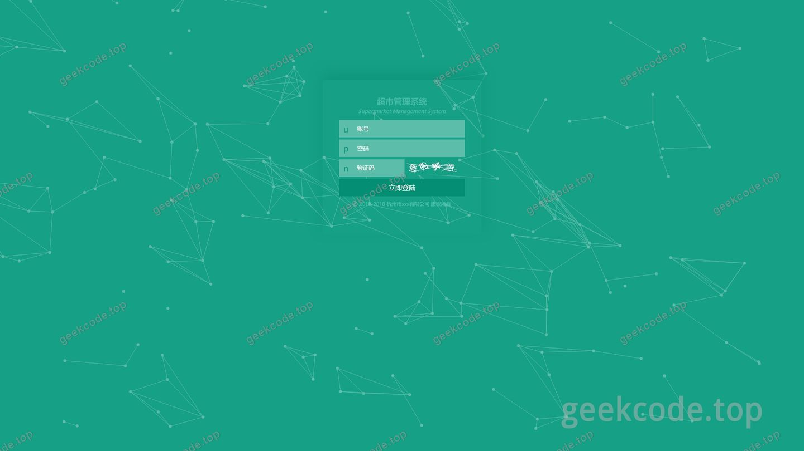
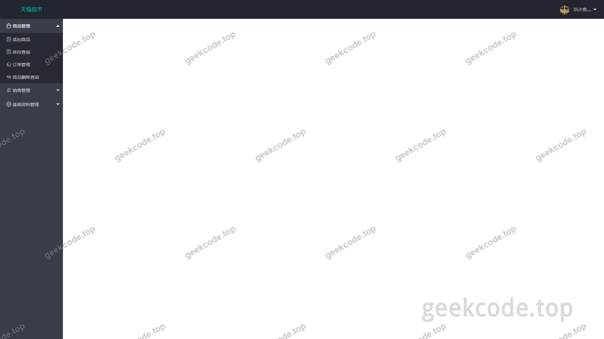
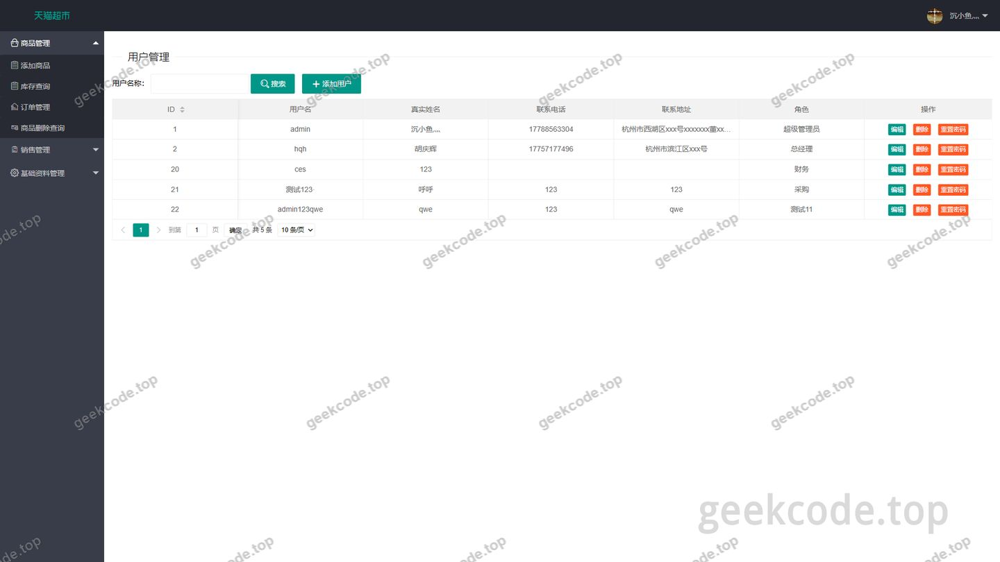
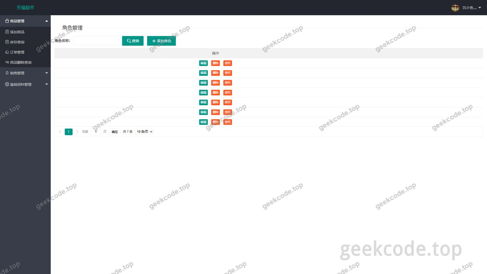
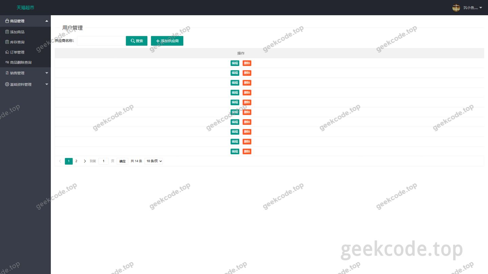
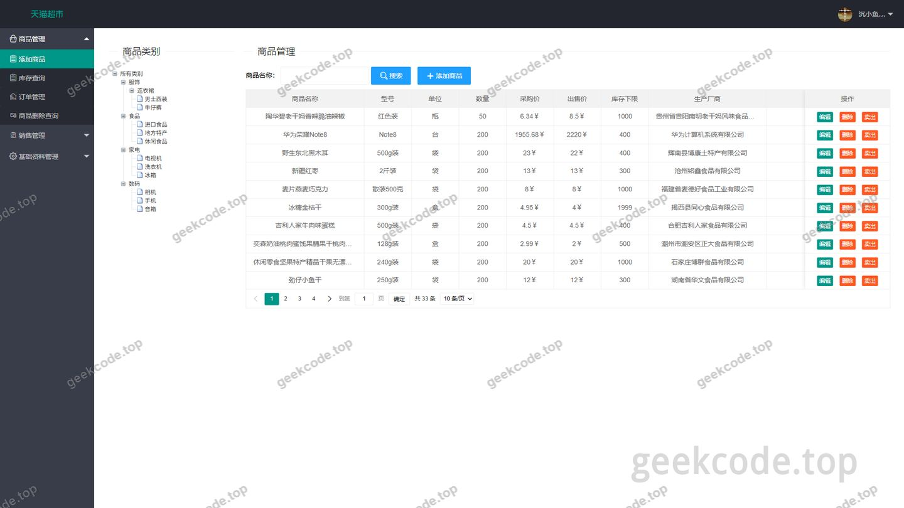
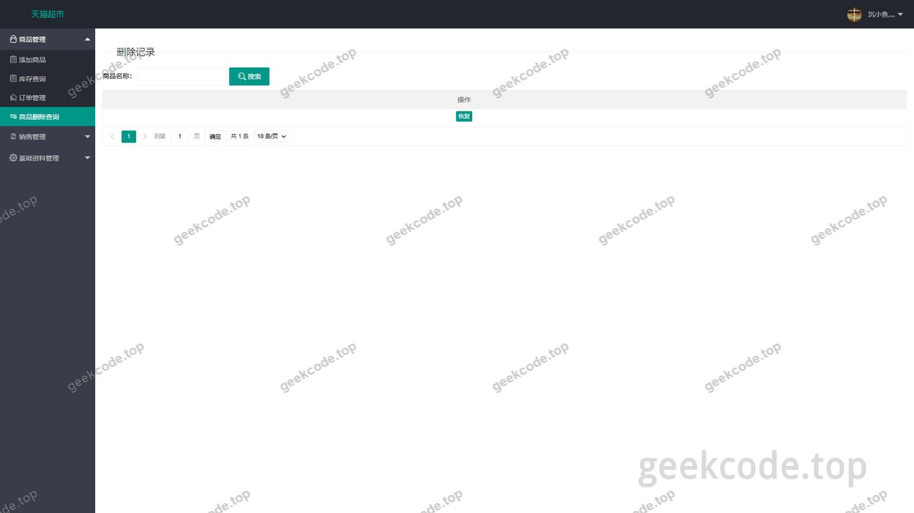
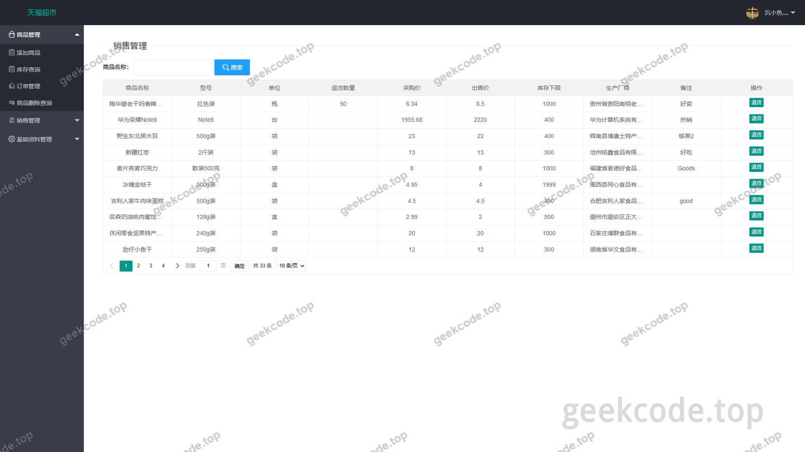

# 基于SSM的超市进销存管理系统

> 🎓 **计算机毕业设计 · 基于SSM的超市进销存管理系统**
>
> 本仓库只放**项目介绍 + 运行截图**（截图是站点带水印的原图，存在仓库 `images/` 里）。
>
> 👉 **完整可运行源码 / 数据库脚本 / 部署文档：[点我获取](https://geekcode.top/archives/%E5%9F%BA%E4%BA%8ESSM%E7%9A%84%E8%B6%85%E5%B8%82%E8%BF%9B%E9%94%80%E5%AD%98%E7%AE%A1%E7%90%86%E7%B3%BB%E7%BB%9F?utm_source=github)**
>
> 💬 咨询微信：**ir9372**　|　🌐 更多项目：[极客代码 geekcode.top](https://geekcode.top/?utm_source=github)
>
> 📌 项目详情页：<https://geekcode.top/archives/%E5%9F%BA%E4%BA%8ESSM%E7%9A%84%E8%B6%85%E5%B8%82%E8%BF%9B%E9%94%80%E5%AD%98%E7%AE%A1%E7%90%86%E7%B3%BB%E7%BB%9F?utm_source=github>

<table><td width="230" align="center"> <b>扫码加微信 ir9372</b></td><td valign="middle">📦 源码 = 项目介绍 + 全部运行截图 + 数据库 + 部署文档 👉 点上方任意截图，直接跳到 <b>极客代码 geekcode.top</b> 详情页</td></table>

---

<h1>基于SSM的超市进销存管理系统</h1>
<h2>项目概述</h2>

本项目名为“基于SSM的超市进销存管理系统”，旨在为中小型超市提供一套轻量级、标准化的信息化管理解决方案。系统核心功能涵盖商品管理、供应商管理及销售退货处理，通过数字化手段优化库存流转效率，减少人工记录误差。适用人群主要为超市管理员及内部运营人员。技术架构采用经典的 SSM（Spring + Spring MVC + MyBatis）框架体系，结合 Shiro 进行安全控制，确保数据访问的安全性与系统的稳定性。虽然项目名称提及“Spring Boot”作为毕设类别背景，但根据实际代码依赖分析，该项目实质构建于传统 Java Web 栈之上，未引入 Spring Boot 自动配置特性，而是侧重于手动集成与分层架构设计，体现了对底层原理的深入实践。

<h2>技术架构</h2>
<h3>前后端架构</h3>

系统采用传统的 MVC 分层架构模式：

<ul>
<li><strong>表现层</strong>：基于 JSP 技术渲染页面，使用 JSTL 标签库简化前端逻辑展示，配合 Servlet API 处理 HTTP 请求与响应。</li>
<li><strong>控制层</strong>：由 Spring MVC 负责接收用户请求，调用业务逻辑，并返回视图或数据模型。</li>
<li><strong>业务层</strong>：利用 Spring Framework 的核心容器（spring-core, spring-beans, spring-context）管理 Bean 的生命周期，并通过 spring-tx 实现声明式事务管理，保证数据一致性。</li>
<li><strong>持久层</strong>：采用 MyBatis 框架进行 SQL 映射与数据库操作，支持动态 SQL 编写，灵活应对复杂的查询需求。</li>
<li><strong>连接池</strong>：集成 Druid 数据库连接池，提供高效的数据库连接管理与监控能力。</li>
</ul>
<h3>核心技术选型理由</h3>
<ul>
<li><strong>Shiro</strong>：用于实现身份认证与授权管理，保障系统登录安全性及资源访问控制。</li>
<li><strong>Druid</strong>：相比其他连接池，Druid 提供了更丰富的监控统计功能，有助于开发阶段排查性能瓶颈。</li>
<li><strong>JSP/Servlet</strong>：尽管现代开发趋向前后端分离，但在本科毕业设计场景中，JSP 能直观展示服务端渲染流程，便于理解 Web 运行机理。</li>
</ul>
<h3>数据库设计要点</h3>

根据截图所示的功能模块，数据库主要包含以下实体关系：

<ul>
<li><strong>用户表 (User)</strong>：存储管理员账号信息，关联角色权限。</li>
<li><strong>角色表 (Role)</strong>：定义系统内的权限组，如超级管理员、普通操作员等。</li>
<li><strong>商品表 (Good)</strong>：记录商品名称、编号、库存数量、价格等基础属性。</li>
<li><strong>供应商表 (Supplier)</strong>：维护供货渠道信息，包括名称、联系方式等。</li>
<li><strong>退货记录表 (Return)</strong>：关联商品与销售订单，记录退货原因、时间及状态。</li>
</ul>
<h2>功能模块</h2>

由于项目定位为后台管理系统且无前台导航菜单，所有功能均面向内部管理端开放。根据截图列表，具体功能模块如下：

<h3>1. 系统登录模块</h3>
<ul>
<li><strong>页面-登录</strong>：提供用户名与密码输入界面，集成 Shiro 进行身份验证。验证通过后跳转至首页，失败则提示错误信息。</li>
</ul>
<h3>2. 首页概览</h3>
<ul>
<li><strong>页面-首页</strong>：作为系统主入口，展示关键业务数据的简要统计或快捷导航链接，帮助用户快速进入各管理子模块。</li>
</ul>
<h3>3. 商品管理模块</h3>
<ul>
<li><strong>页面-good新增</strong>：允许管理员录入新商品信息，包括基本属性设置。</li>
<li><strong>页面-good删除</strong>：提供商品下架或删除功能，支持按条件筛选并执行删除操作，需二次确认以防误删。</li>
</ul>
<h3>4. 供应商管理模块</h3>
<ul>
<li><strong>页面-supplier</strong>：实现对供应商信息的增删改查，维护超市的上游供货关系网络。</li>
</ul>
<h3>5. 退货管理模块</h3>
<ul>
<li><strong>页面-return</strong>：处理客户或门店发起的退货申请，记录退货详情并更新相关库存状态。</li>
</ul>
<h3>6. 系统与权限管理模块</h3>
<ul>
<li><strong>页面-用户信息</strong>：查看和管理系统用户的个人资料，支持修改基本信息。</li>
<li><strong>页面-role信息</strong>：配置系统角色及其对应的权限集合，实现基于角色的访问控制（RBAC）。</li>
</ul>
<h2>用户角色与权限</h2>

系统基于 Apache Shiro 实现细粒度的权限控制。根据现有截图中的“role信息”和“用户信息”模块，可推断系统存在至少两类角色划分机制：

<h3>1. 超级管理员 (Super Admin)</h3>
<ul>
<li><strong>权限范围</strong>：拥有系统最高权限。</li>
<li><strong>可访问模块</strong>：<ul>
<li>全部业务模块：商品管理（新增/删除）、供应商管理、退货管理。</li>
<li>全部系统模块：用户信息管理、角色权限配置。</li>
<li>系统登录与首页访问。</li>
</ul>
</li>
</ul>
<h3>2. 普通操作员 (Operator)</h3>
<ul>
<li><strong>权限范围</strong>：受限的业务操作权限，通常不具备系统配置权。</li>
<li><strong>可访问模块</strong>：<ul>
<li>业务模块：可能仅允许查看或特定操作商品、供应商及退货数据（具体取决于 Role 表配置）。</li>
<li>个人模块：仅限修改自己的“用户信息”。</li>
<li>禁止访问：“role信息”配置页及部分高危操作（如批量删除）。</li>
</ul>
</li>
</ul>

<em>注：具体角色间的权限差异需在“role信息”页面中动态配置，系统本身不硬编码固定角色，而是通过数据库关联实现灵活授权。</em>

<h2>项目特色与创新点</h2>
<ol>
<li><strong>经典架构的深度实践</strong>：摒弃了高度封装的自动化框架，采用原生 SSM 组合，强制开发者手动处理配置、事务及连接池，深刻体现了对 Java EE 规范的理解与应用能力。</li>
<li><strong>完整的安全闭环</strong>：集成 Shiro 框架，不仅实现了基础的登录认证，还通过 Role/User 模块构建了完整的 RBAC（基于角色的访问控制）体系，确保了多用户环境下的数据安全。</li>
<li><strong>业务场景贴合度高</strong>：聚焦超市进销存的核心痛点——商品生命周期管理（入库、出库、退货）与供应链关系维护，功能模块虽小但逻辑完整，具备实际落地价值。</li>
<li><strong>监控与维护友好</strong>：引入 Druid 连接池，为后续的性能调优和故障排查提供了内置的监控视角，提升了系统的可维护性。</li>
</ol>
<h2>部署环境</h2>

为确保系统正常运行，需准备以下软件环境：

<table>
<thead>
<tr>
<th align="left">组件</th>
<th align="left">版本要求</th>
<th align="left">说明</th>
</tr>
</thead>
<tbody><tr>
<td align="left"><strong>操作系统</strong></td>
<td align="left">Windows / Linux</td>
<td align="left">建议 Windows 10/11 或 CentOS 7+</td>
</tr>
<tr>
<td align="left"><strong>JDK</strong></td>
<td align="left">1.8 或以上</td>
<td align="left">必须安装 JDK 并配置环境变量</td>
</tr>
<tr>
<td align="left"><strong>Web 服务器</strong></td>
<td align="left">Tomcat 8.5 或 9.0</td>
<td align="left">用于部署 WAR 包，解析 JSP 与 Servlet</td>
</tr>
<tr>
<td align="left"><strong>数据库</strong></td>
<td align="left">MySQL 5.7 或 8.0</td>
<td align="left">需创建对应数据库实例及表结构</td>
</tr>
<tr>
<td align="left"><strong>开发工具</strong></td>
<td align="left">IntelliJ IDEA / Eclipse</td>
<td align="left">推荐 IDEA，便于 Maven 依赖管理</td>
</tr>
<tr>
<td align="left"><strong>构建工具</strong></td>
<td align="left">Maven 3.6+</td>
<td align="left">用于编译打包及依赖下载</td>
</tr>
<tr>
<td align="left"><strong>浏览器</strong></td>
<td align="left">Chrome / Edge</td>
<td align="left">建议使用现代浏览器以获得最佳兼容性</td>
</tr>
</tbody></table>

<strong>部署步骤简述</strong>：

<ol>
<li>导入项目源码至 IDE，配置 Maven 仓库以下载 <code>javax.servlet-api</code>, <code>jstl</code>, <code>spring-*</code> 等依赖。</li>
<li>在 MySQL 中执行初始化 SQL 脚本，建立 User, Role, Good, Supplier, Return 等表。</li>
<li>修改项目配置文件（如 <code>jdbc.properties</code>），填入正确的数据库 URL、用户名和密码。</li>
<li>将项目打包为 WAR 文件，部署至 Tomcat 服务器的 <code>webapps</code> 目录。</li>
<li>启动 Tomcat，访问 <code>http://localhost:8080/[项目名]/login.jsp</code> 进行测试。</li>
</ol>
<h2>五、技术特性</h2>
<ul>
<li>服务端模板渲染（JSP）</li>
<li>集成 Shiro 权限框架实现角色权限控制</li>
</ul>
<h2>六、功能模块截图</h2>
<h3>后台管理端</h3>
<h4>页面-登录</h4>

<h4>页面-首页</h4>

<h4>页面-用户信息</h4>

<h4>页面-role信息</h4>

<h4>页面-supplier</h4>

<h4>页面-good新增</h4>

<h4>页面-good删除</h4>

<h4>页面-return</h4>

---

## 获取完整源码

| 项目 | 说明 |
| --- | --- |
| 项目名 | 基于SSM的超市进销存管理系统 |
| 运行截图 | 本文 8 张（站点带水印原图，仓库 `images/` 目录） |
| 完整源码 | [https://geekcode.top/archives/%E5%9F%BA%E4%BA%8ESSM%E7%9A%84%E8%B6%85%E5%B8%82%E8%BF%9B%E9%94%80%E5%AD%98%E7%AE%A1%E7%90%86%E7%B3%BB%E7%BB%9F?utm_source=github](https://geekcode.top/archives/%E5%9F%BA%E4%BA%8ESSM%E7%9A%84%E8%B6%85%E5%B8%82%E8%BF%9B%E9%94%80%E5%AD%98%E7%AE%A1%E7%90%86%E7%B3%BB%E7%BB%9F?utm_source=github) |
| 咨询微信 | **ir9372**（备注：jingpin-yuanma） |
| 更多项目 | [极客代码 geekcode.top](https://geekcode.top/?utm_source=github) |

> 需要源码、部署、改配置、跑不起来等问题，加微信 ir9372 沟通，说明项目名即可。
